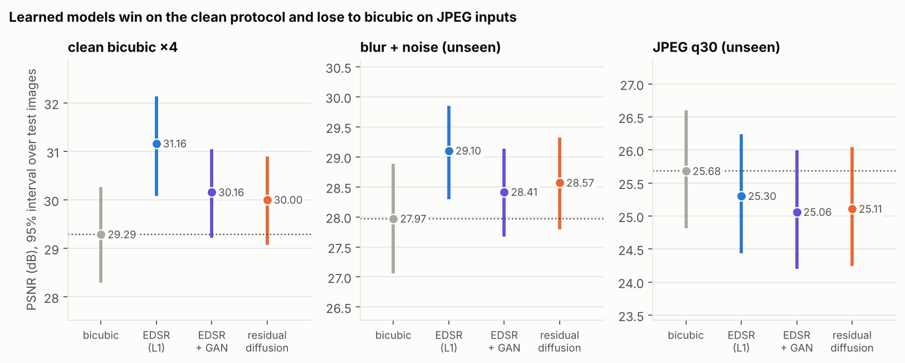
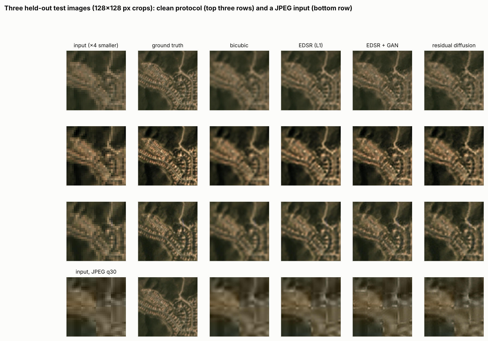
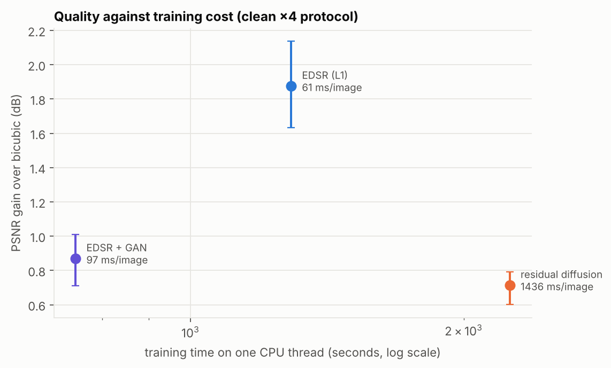
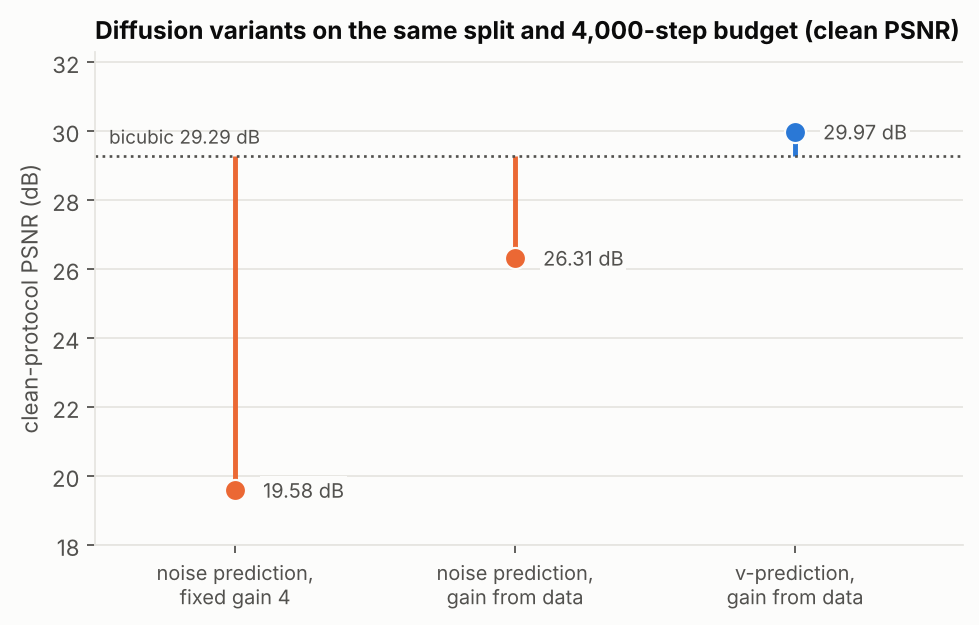

# VisionForge

Image **super-resolution** research code: a compute-budgeted comparison of regression,
adversarial and diffusion models, with proper statistics and cost reporting.

Three independently installable packages with one-way dependencies:

```
visionforge-datasets  ──▶  visionforge-models  ──▶  visionforge-lab
 degradations, paired       EDSR, GAN, residual        study with explicit,
 reported budgets,
 patches, image-level       diffusion (DDPM/DDIM),     benchmark harness, bootstrap
 splits (numpy, scipy)      PSNR/SSIM (torch)          stats, report (torch)
```

| Package | Responsibility |
|---|---|
| [`visionforge-datasets`](visionforge-datasets) | bicubic / blur+noise / JPEG degradations, aligned patch sampling, image-level splits with audit, checksum manifests |
| [`visionforge-models`](visionforge-models) | models written from scratch, noise schedules, EMA, budgeted training loops, metrics |
| [`visionforge-lab`](visionforge-lab) | study runner, tiled inference, per-image metrics with CIs, paired tests, latency / memory, report |

## Research question

With explicit and reported training budgets, where do an L1-trained EDSR, an
adversarially fine-tuned EDSR and a few-step conditional residual diffusion model land in
quality (PSNR/SSIM), cost (parameters, training time, latency, memory) and robustness to
degradations unseen in training? The contribution would be a reproducible comparison with reported
training cost; the field is crowded and no state-of-the-art claim is made.

## Status (honest summary)

| Item | State |
|---|---|
| All packages implemented; 38 unit tests pass (closed-form metric checks, reproducible sampling, budget stopping, v/eps parameterisation consistency, group-aware splits, end-to-end study on tiny synthetic images) | yes |
| Experiments on real imagery | **run on SpaceNet 7 satellite mosaics** (CPU, one seed, 8 test images); DIV2K and the standard natural-image test sets were unreachable |
| GPU / CUDA / mixed-precision code paths | written, **never executed** (the development container has no GPU); CPU paths are what the tests cover |
| LPIPS / perceptual metrics, transformer-based SR (SwinIR-style) | not implemented |
| Published numbers | none |

## Results on real satellite imagery (CPU, one seed)

Data: SpaceNet 7 monthly Planet mosaics (about 4 m per pixel; CC BY-SA 4.0, verify at
spacenet.ai), 30 areas × 3 dates, 80 usable images after dropping cloud-masked ones, split
**by area** (64 train / 8 validation / 8 test images, no location shared). ×4 super-resolution,
patch 64, batch 16. Training images centre-cropped to ≤512 px; the 8 test images to 256 px
(to bound diffusion sampling cost). PSNR/SSIM on luma, border shaved. Tables and commands:
[`visionforge-lab/results/satellite/`](visionforge-lab/results/satellite) (the earlier, smaller
run is kept in `earlier_runs/`).



| system (clean bicubic ×4 input) | PSNR [95% CI over images] | SSIM | Δ PSNR vs bicubic [95% CI] | train steps / seconds | latency per 256² output |
|---|---|---|---|---|---|
| bicubic | 29.29 [28.32, 30.23] | 0.8263 | — | — | 1 ms |
| EDSR (L1, 0.52 M params) | **31.16** [30.12, 32.10] | **0.8771** | +1.87 [+1.63, +2.14] | 3,000 / 1,291 s | 61 ms |
| EDSR + adversarial fine-tuning | 30.16 [29.25, 31.01] | 0.8415 | +0.87 [+0.71, +1.01] | 1,500 / 747 s | 97 ms |
| residual diffusion (DDIM-10, 0.49 M params) | 30.00 [29.10, 30.86] | 0.8367 | +0.71 [+0.60, +0.79] | 5,000 / 2,249 s | 1,436 ms |

Inputs the models never saw in training (PSNR; Δ vs bicubic in brackets):

| degradation | bicubic | EDSR | EDSR + adversarial | residual diffusion |
|---|---|---|---|---|
| blur + noise | 27.97 | 29.10 (+1.13) | 28.41 (+0.44) | 28.57 (+0.60) |
| JPEG (quality 30) | 25.68 | 25.30 (−0.38) | 25.06 (−0.62) | 25.11 (−0.57) |





What this supports:

- All three learned models beat bicubic on the clean protocol and on blur+noise, and the
  plain L1 regression network is best on PSNR/SSIM at a fraction of the cost. A larger EDSR
  trained twice as long than in the first run (see `earlier_runs/`) gained +0.34 dB over it
  (31.16 vs 30.82 dB); the adversarial model was *worse* than its earlier version (30.16 vs
  30.39 dB), so more effort did not help every system.
- All three are *worse than bicubic* on JPEG-compressed inputs, an artefact type absent
  from training: they treat compression blocks as detail to sharpen. Robustness to unseen
  degradations is the weak point of all three.
- Adversarial fine-tuning and diffusion cost PSNR/SSIM relative to L1 regression, as the
  perception–distortion trade-off predicts, **but no perceptual metric was measured**, so
  nothing here shows they look better. In the example crops the differences between the
  learned models are small compared with the gap to the ground truth.

Limits you should keep in mind:

- This is **not a compute-matched comparison**. EDSR got 3,000 steps, the adversarial stage
  1,500 and diffusion 5,000 (about 1.7× EDSR's training time); the table reports steps and
  seconds so you can judge.
- Eight test images and one seed. The intervals are over images, and "p = 0.000" in the full
  report only means below the bootstrap's resolution, not a precise probability.
- Small models, short schedules and 4 m satellite imagery: no claim about natural photos or
  published benchmarks.

### Defects found and fixed while running on real data

The unit tests passed while the diffusion model was badly wrong; the real data exposed it.
Same data, same split, 4,000-step budget (fixed-gain run: 1,500 steps),
`visionforge-lab/results/satellite/ablation_diffusion_variants/` and `earlier_runs/`:



| diffusion variant | clean PSNR / SSIM | note |
|---|---|---|
| noise prediction, fixed residual gain 4 (1,500 steps) | 19.58 / 0.285 | residual std is 0.031, so the signal sat at 0.12 against unit-variance noise |
| noise prediction, gain estimated from data (4,000 steps) | 26.31 / 0.612 | still far below bicubic (29.29) |
| **v-prediction**, gain estimated from data (4,000 steps) | **29.97 / 0.835** | final model |

At an identical 800-step budget on 6 crops (one seed), noise prediction reached 23.04 dB
and v-prediction 30.94 dB against 31.67 dB for bicubic. The cause: a cosine schedule leaves
almost no signal at the last step (√ᾱ ≈ 0.006), so recovering the clean estimate from a
noise prediction amplifies any network error about 160×; v-prediction avoids that division.
Both fixes are covered by unit tests.

The study command (CPU run shown above; the code also uses a CUDA GPU if present):

```bash
git clone https://github.com/saaki05/project-5 && cd project-5
pip install -e visionforge-datasets -e visionforge-models -e visionforge-lab
visionforge-lab study --images /path/to/hr_images --scale 4 --steps 20000 --patch 96 \
    --out results/study.json
visionforge-lab report --results results/study.json
```

## Regenerating the figures

Every figure in `docs/figures/` is produced from the result files by a script (no number is
typed by hand). `pip install matplotlib`, then:

```bash
python scripts/make_figures.py
```

## License

MIT. Image datasets carry their own licenses.
