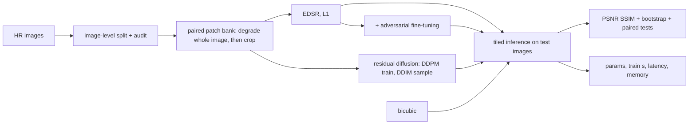

# VisionForge: methodology and paper outline

## Architecture

## Models

- **EDSR-style CNN** predicting a residual over bicubic upsampling, L1 loss.
- **Adversarial fine-tuning** of the same generator with a spectral-norm PatchGAN
  discriminator and a non-saturating loss; no VGG perceptual term (offline requirement).
- **Residual diffusion**: a time-conditioned U-Net predicts the noise added to
  `HR − bicubic(LR)` given the bicubic image; cosine schedule, EMA weights, DDIM sampling with
  few steps; deterministic for a fixed seed.

## Protocol

- Images (not patches) are split into train / validation / test; the split is audited.
- All learned models share the patch bank, patch size, batch size and step budget; an
  optional wall-clock budget equalises compute time; training seconds and parameter counts
  are reported.
- Evaluation on held-out images under `bicubic` (clean), `blur_noise` and `jpeg` inputs;
  PSNR/SSIM on the Y channel with the border shaved by the scale factor.
- Bootstrap CIs over test images; paired bootstrap differences against bicubic.

## Threats to validity

- PSNR/SSIM are not perceptual: they reward smooth outputs. Without LPIPS or a user study,
  claims about perceptual quality are not supported.
- Equal steps are not equal compute across families; both are reported.
- Small models and short schedules do not reproduce published numbers.
- Test-set size controls the width of the confidence intervals.

## Paper outline (fill only from `results/study.json`)

1. Introduction: the perception–distortion trade-off at low compute.
2. Related work: EDSR, SRGAN/ESRGAN, DDPM/DDIM, residual diffusion for SR.
3. Method: models and the budget-matched protocol.
4. Results: quality, cost, robustness to unseen degradations.
5. Limitations (no learned perceptual metric, small models) and conclusion.
